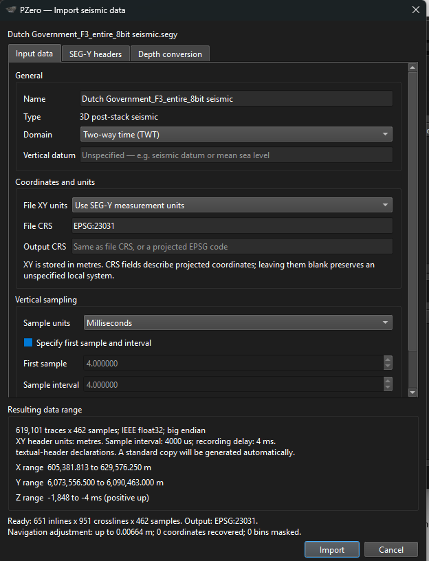
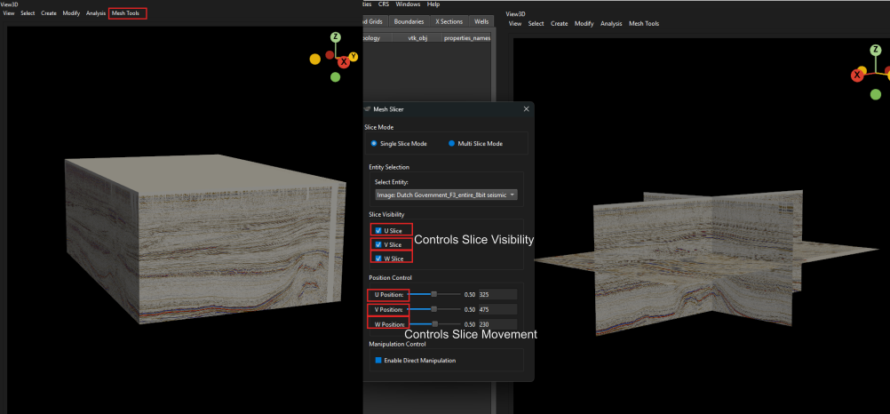
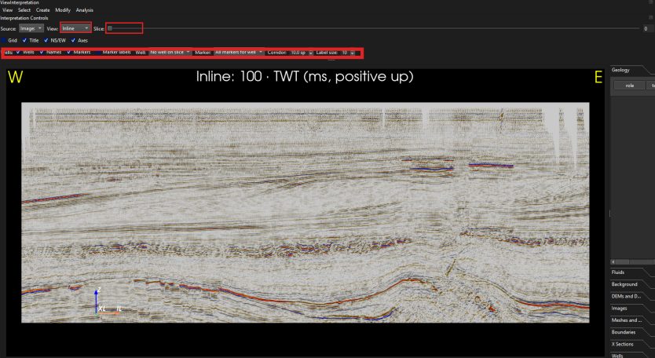
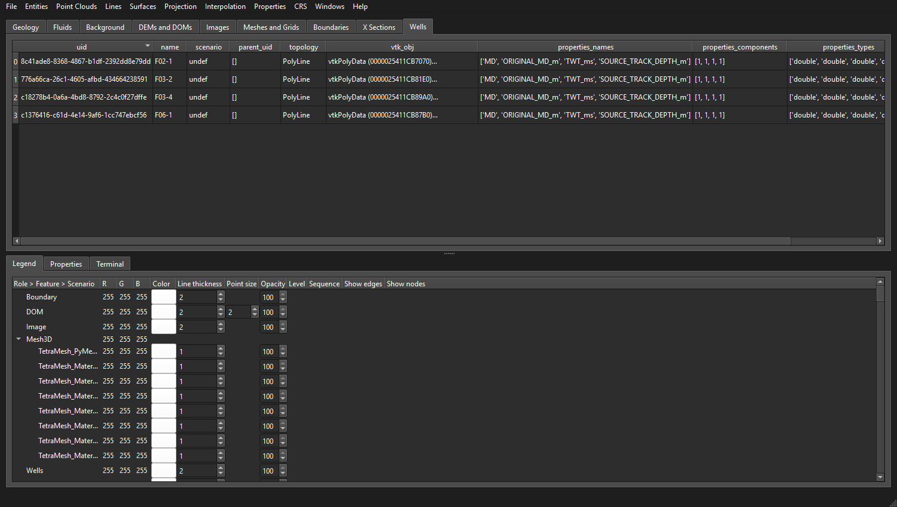
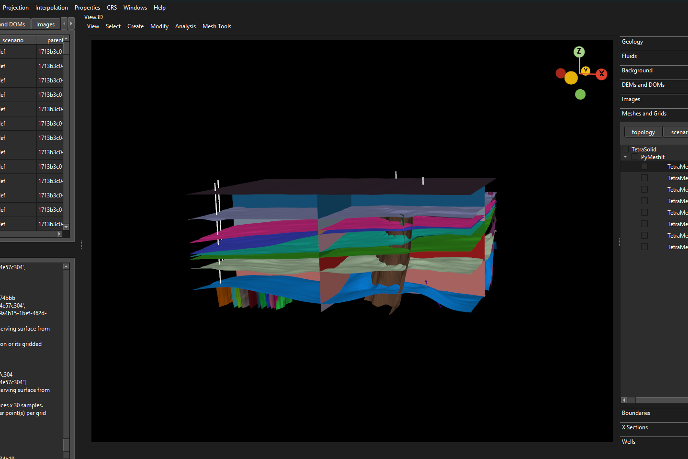
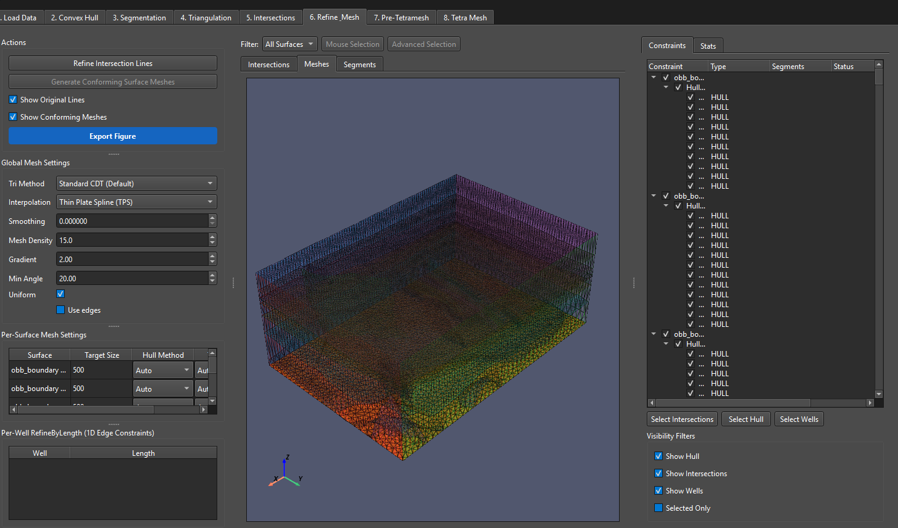
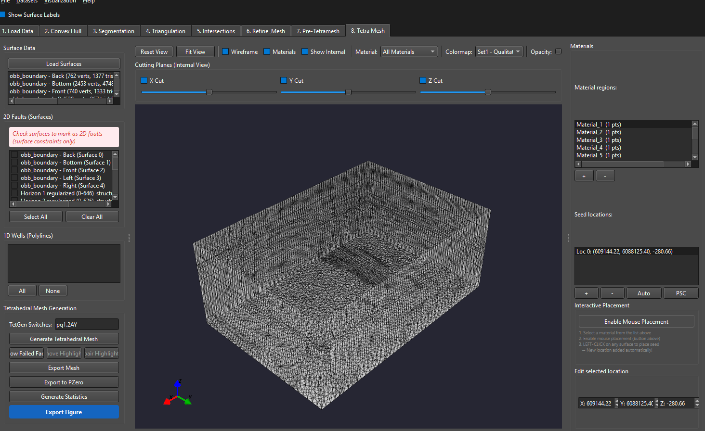

# Revisit the F3 manuscript model in PZero

This short tutorial opens the supplied results: the F3 seismic interpretation,
geological surfaces, four wells and tetrahedral mesh. Follow the manuscript for
the reconstruction methodology and parameter choices.

| Step | Result |
| --- | --- |
| [1. Install PZero](#1-install-the-manuscript-version-of-pzero) | Manuscript software version |
| [2. Download the data](#2-download-the-f3-data) | Project files and original SEG-Y |
| [3. Open final9](#3-open-the-supplied-final9-project) | Saved interpretations and models |
| [4. Reconnect the seismic](#4-import-and-reconnect-the-seg-y-volume) | Interpretations linked to the imported volume |
| [5. Inspect interpretations and wells](#5-visualize-horizons-faults-and-wells) | Seismic slices, picks and well markers |
| [6. Inspect surfaces](#6-inspect-the-reconstructed-geological-surfaces) | Reconstructed horizons and faults |
| [7. Inspect the tetrahedral mesh](#7-open-the-pymeshit-project-and-inspect-the-tetrahedral-mesh) | Saved PyMeshIt results |

## 1. Install the manuscript version of PZero

The manuscript uses **PZero 2.0.0**.


For a packaged build, extract the complete archive into a writable folder and
launch PZero. Keep the bundled files together. The required interface includes
**File > Import SEGY**, **Windows > Interpretation Window** and
**Interpolation > Pymeshit**. PyMeshIt is embedded in this workflow.

## 2. Download the F3 data

Download this repository using **Code > Download ZIP** on the
[repository page](https://github.com/gecos-lab/PZero_Seismicdata), then extract
it. Alternatively:

```bash
git clone https://github.com/gecos-lab/PZero_Seismicdata.git
```

Download **`Dutch Government_F3_entire_8bit seismic.segy`** separately from the
[F3 seismic download folder](https://drive.google.com/drive/folders/0B7brcf-eGK8CbGhBdmZoUnhiTWs?resourcekey=0-0ZhV_OJ3TKN1ShFAGcrOzQ).
Keep it in a stable location on your computer. This is the export used by the
supplied project; another F3 export may have different headers or sampling.

Check that these files are available:

```text
PZero_Seismicdata/
  final9/
    final9.p0
    final9_p0/                 # keep the complete companion folder
  PyMeshIt project/
    seis2_aligned.pmit
  wells/
    converted/
```

The raw seismic volume is intentionally excluded from the repository.

## 3. Open the supplied final9 project

In the PZero main window, choose **File > Open Project** and select
[`final9/final9.p0`](../final9/final9.p0). Keep `final9_p0/` beside this file;
the small `.p0` file points to the tables and geometry in that folder.

Check the **Geology**, **Wells**, and **Meshes and Grids** collections. The
saved project contains interpretation lines, reconstructed surfaces, four
wells, 72 well markers and exported tetrahedral meshes. The **Images**
collection starts empty because the seismic is downloaded separately.

Choose **Windows > 3D View** to inspect the geometry. Hide the outer boundary
and volume meshes initially if they obscure the interpretations.

## 4. Import and reconnect the SEG-Y volume

Choose **File > Import SEGY** and select the downloaded file. In the import
dialog, use the settings recorded for this project:

| Setting | F3 project value |
| --- | --- |
| Domain | Two-way time (TWT) |
| File XY units | Metres from the SEG-Y header |
| File CRS | `EPSG:23031` |
| Output CRS | Same as file CRS |
| Sample units | Milliseconds |
| First sample / sample interval | 4 ms / 4 ms |
| Depth conversion | Keep source domain |
| Stored vertical direction | Positive up; negative TWT below the datum |

In **SEG-Y headers**, leave automatic detection enabled and use **Read headers
and preview**. For this export, the one-based starting bytes are inline **5**,
crossline **21**, X **73** and Y **77**, each four bytes wide. Confirm these
against the preview before overriding detection. The expected grid is
**651 inlines × 951 crosslines × 462 samples**.



*Figure 1. Import settings for the supplied F3 export.*

Click **Import** and wait for loading to finish. In **Link interpreted
entities**, select the existing horizon/fault group rather than **Do not link
interpreted entities**, then confirm. This associates the saved
interpretations with the imported seismic and aligns linked legacy geometry
to its coordinate frame. Save the project to retain the links.

In **3D View**, enable the seismic under **Images** and select its **intensity**
property. Use **Mesh Tools > Mesh Slicer** to view interior slices. If needed,
set the intensity colour map to `seismic_pzero` in **Properties**.



*Figure 2. Use interior slices to check the seismic geometry.*

## 5. Visualize horizons, faults and wells

Open **Windows > Interpretation Window**. Select the imported seismic as
**Source**, choose **Inline**, and move the **Slice** slider. Repeat with
**Crossline** and **Z-slice**. Enable the relevant interpretation lines in the
view tree and check their position against the reflectors and fault offsets.
In **3D View**, display the same horizon and fault lines together.



*Figure 3. Slice controls allow the interpretation to be examined across the
volume.*

In the 3D view's **Wells** tree, enable **F02-1**, **F03-2**, **F03-4** and
**F06-1**. Expand each well and enable **Markers** to inspect the stratigraphic
markers alongside the horizons. These wells are already loaded; importing
their workbooks again would add duplicates. For a fresh project, the
[`wells/converted/`](../wells/converted/) workbooks can be loaded using
**File > Import Well Data**; see the [well instructions](../wells/README.md).



*Figure 4. The four wells are already present in the supplied project.*

Use **View > Vertical exaggeration** and enter **5** if the time-domain model
looks too flat. This changes the display scale. X/Y remain in metres and Z
remains negative TWT in milliseconds; interpreting physical thicknesses or
volumes requires a suitable time-to-depth conversion.

## 6. Inspect the reconstructed geological surfaces

In **Geology**, identify entities with topology **TriSurf**. For example,
display **Horizon 3 (0-644)_delaunay2d**,
**Horizon 5 (0-626)_delaunay2d**, and
**Main Fault 1 (0-255)_structured_surface** in the 3D view. The project also
contains alternative surface representations and copies in the **PyMeshIt**
scenario; display one representation at a time to avoid overlapping copies.

Hide the solid seismic cube and tetrahedral meshes, then rotate the model.
Compare individual surfaces with their source lines and seismic slices. Look
at horizon continuity, fault offsets, surface intersections and the model
boundary. The supplied surfaces are already reconstructed; no interpolation
or smoothing is required to inspect them.



*Figure 5. Reconstructed geological geometry displayed in PZero.*

## 7. Open the PyMeshIt project and inspect the tetrahedral mesh

In the PZero main window, choose **Interpolation > Pymeshit**. In the PyMeshIt
window, choose **File > Load Project...** and open
[`PyMeshIt project/seis2_aligned.pmit`](../PyMeshIt%20project/seis2_aligned.pmit).
Use this aligned project when comparing with `final9`.

Inspect the saved triangulations and intersections in **4. Triangulation**,
**5. Intersections**, and **6. Refine & Mesh**. Then open **8. Tetra Mesh** to
inspect the saved volume mesh. You do not need to press **Generate Tetrahedral
Mesh** to view the supplied result.



*Figure 6. Prepared surfaces and intersections in the PyMeshIt workflow.*

Rotate and zoom the tetrahedral mesh. Use the material visibility controls and
cutting planes to inspect internal regions. Select **Generate Statistics** to
review the saved mesh's counts and quality measures. The supplied aligned
project contains **86,059 points and 497,648 tetrahedra**. These describe a
time-domain mesh in the stored metre/millisecond coordinates.



*Figure 7. Inspect the volume mesh in the Tetra Mesh tab.*

For comparison in PZero, enable **TetraMesh_PyMeshIt** under **Meshes and
Grids**, and select **MaterialID** to distinguish regions. The individual
**TetraMesh_Material_*** entries are also available; display either the full
mesh or selected material meshes to avoid overlapping geometry.

<details>
<summary>Troubleshooting</summary>

- **Missing project folder:** extract the complete repository and keep
  `final9.p0` beside `final9_p0/`.
- **Interpretations absent from seismic slices:** verify the seismic Source,
  visibility checkboxes and the group selected in **Link interpreted
  entities**. If linking was skipped, reopen the unmodified supplied project
  and repeat the import.
- **Opaque box hides the model:** hide the boundary and volume meshes; inspect
  seismic slices and individual surfaces instead.
- **Wells or surfaces appear displaced:** compare the SEG-Y import settings
  with the table above and the [recorded coordinate metadata](../wells/coordinate_system.json).
  Use the aligned `.pmit` file and preserve the TWT convention.
- **Required menus are missing:** check that you have the manuscript's
  seismic/PyMeshIt build of PZero 2.0.0.

</details>

Screenshot provenance is recorded in [screenshots/README.md](screenshots/README.md).
F3 data originate from NAM through NLOG and were distributed by dGB Earth
Sciences. See the [repository acknowledgements and licence](../README.md#acknowledgements-and-licence)
for attribution and reuse terms.
